# PatentLens 企业场景图文指南

这份指南面向企业知识产权专员。用一个合成的散热专题说明：收到文献后如何登记，如何寻找技术信息，何时需要解析，怎样向研发说明两篇方案的差异，以及如何保存研究。全部截图来自真实运行的浏览器；`EP9000001A1` 等编号、权利要求和 EPO 格式链接均为 **Synthetic／合成占位，绝非真实专利来源**。请在干净克隆或隔离演示环境使用，勿混入企业资料。[产品能力与限制](capabilities.md)。

## 开始：先确定要完成的任务

在项目目录运行 `npm ci`、`npm run demo:portfolio`（需 Node.js 24+），打开 `http://127.0.0.1:4323/workspace`。无需 API Key。首页四条路径分别是解析一篇、检索技术方案、比较两篇、管理研究项目；登记册放在“高级工具”的旧版 Pilot 入口，也可直接访问 `/pilot`。本指南的[三篇合成登记样本](demo-registry.json)可供导入。演示专利不应进入已有私人登记册。

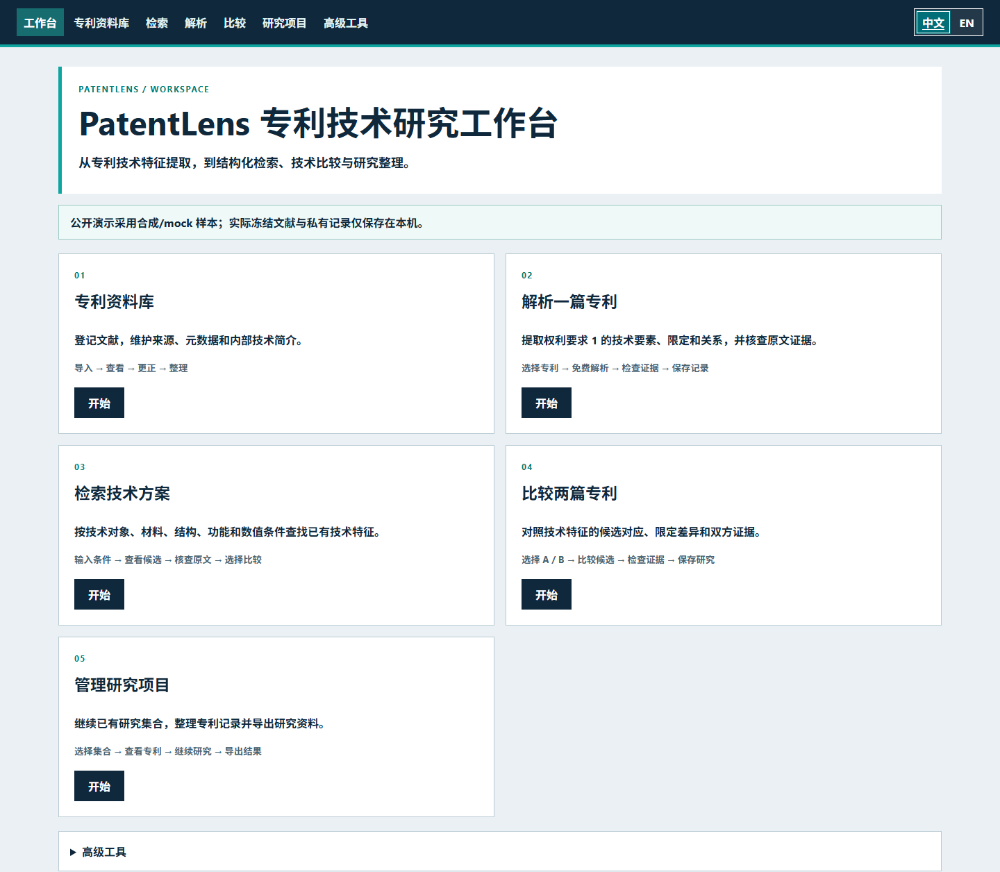

*在这里按业务目的选路；系统只提供入口，不会自动解析或发起付费调用。*

## 场景 A：收到一批专利资料，如何登记和整理？

**何时用：**研发、代理所或内部同事发来文献清单，需要知道“收到了哪一篇、资料来自哪里、谁改过标题”，避免重复建档。`/pilot` 的 **CSV／JSON 导入**读取文件里的公开号及可选的标题、摘要、申请人、日期、IPC／CPC、独立权利要求文本和来源链接；缺失字段仍是缺失，不会自动补全文。**EPO XML 导入**则按 EP 公开号实时读取可获得的官方来源字段，需要联网，可能因服务不可达而失败。登记册保存字段值、来源状态、导入时间和可选的独立权利要求；它不是一个保证完整的原文档案。公开号是去重依据：重复导入不会默默覆盖人工更正。

容易混淆的“**新建手动输入／导入文本**”在 `/patent-search`：它把你粘贴的权利要求、可选摘要和说明书放入**当前原文与测试区**，供阅读或运行测试，**不会自动登记到 `/pilot`，也不是上传完整专利全文**。需要长期维护的资料请用登记入口。不要把来源未核验的粘贴内容当作官方原文。

**跟着操作：**打开 `/pilot`，选择 `demo-registry.json` 并点“导入文件”，应看到三条登记记录。重复导入同一文件，数量仍为三。输入完整 `EP9000002A1` 或部分 `9000002` 查找，清空搜索恢复列表；点击卡片进入详情。公开号搜索忽略大小写及常见空格、连字符差异。

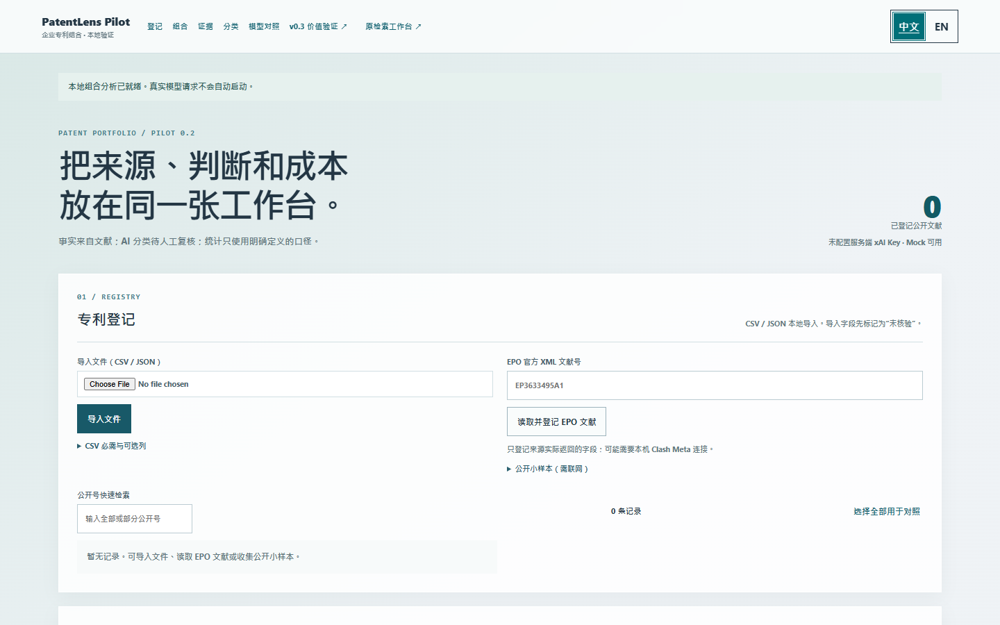

*选择本地文件，系统提取可识别字段并登记；导入状态并不代表来源已核实。*

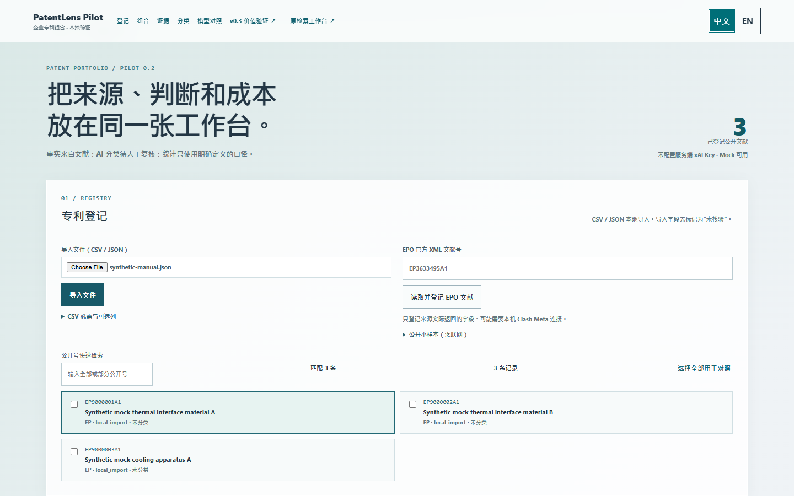

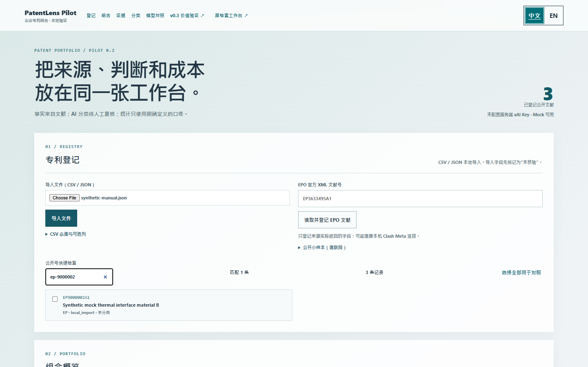

*快速缩小登记列表，不会修改记录或排序。*

如果标题有误，选 `EP9000001A1`，在“来源事实与证据”展开“编辑元数据”，选择标题，填写新值、修改人和原因后保存；再展开“修订历史”，核对原值、新值、时间和原因。这样讨论时能说明为何内部标题与导入资料不同，同时保留原始来源。公开号、原文和证据身份字段不在此更改。修改人只是**自填标识，未经身份认证**。

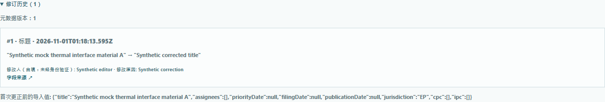

*历史保留导入值和修改原因；企业可追溯人工整理过程。*

已初步阅读、希望按内部主题分组时，可在“人工技术标签”输入 `vapor chamber; plate`、填写修改人并保存；再次编辑可修改或删除。标签是人的整理意见，**不是**机器解析出的技术要素，也不证明技术事实。示例故意说明：标签可能只是待核查线索。

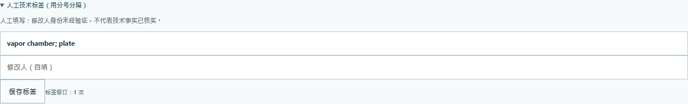

## 场景 B：检索并整理某个技术领域

**先选对检索范围：**`/patent-search` 可查外部来源，得到候选公开号、摘要片段或来源链接；网络与来源可能不完整，搜索结果不会自动进入登记册。`/pilot` 检索的是**本机已登记文献**，可按公开号、申请人、法域、日期等现有字段整理。`/patent-repository?task=search` 查的是**已经建立 Feature Record 的技术特征记录**，能按技术对象、要素、限定、关系或数值条件筛选。没有解析过的登记专利，不一定出现在特征库结果中，不能因此认定该专利没有相关技术。

关键词或原文搜索是**文本候选命中**；结构化字段命中表示某个机器／人工修订记录里存在对应字段。两者都要回看 Claim 1，不能当作技术等同或完整检索结论。企业可先在登记册用人工标签聚拢“散热／电池／充电”小专题，再对关键文献做解析、核查证据，保存到研究集合。标签没有自动同步成 Feature Record。旧版 `/pilot` 有记录数、申请年份、申请人、法域统计，技术领域分布仅计已确认分类；它尚未与研究集合形成统一的企业组合看板。

**操作路线：**在 `/pilot` 找到样本并打开详情；如已解析，到特征库输入 `resin` 等要素词，区分字段命中与文本候选，再打开单篇特征查看原文。选择结果加入研究集合。若尚未解析，先阅读登记中的独立权利要求，仍可用场景 D 的人工研究方式保存。

## 场景 C：解析一篇专利有什么意义？

原始 Claim 1 是法律文本，要理解结构与限定，仍必须读原文。**解析**不是重新生成全文：免费 Rules 或可选的 Grok 尝试把其中的技术主体、**Elements（要素）**、**Limitations（限定）**、**Relationships（关系）**拆成可检索的候选字段，并附上原文位置。这样可以按具体部件筛选、查看数值基准、对比另一篇、把发现连同证据存进集合。普通使用者关注“字段是否忠实于原文”，无需学习底层 Schema。

**真实演示结果：**合成 `EP9000001A1` 的 Claim 1 写有 `non-silicone resin comprising a phase change material`。当前 Rules 实际识别出独立的 `resin` 与 `phase change material`，把 `non-silicone` 作为树脂限定，并提出“树脂包含相变材料”的候选关系。原文另写 `plasticizer present at between 25 and 50 percent by weight of the non-silicone resin`；解析结果把 `plasticizer` 设为要素，比例设为限定，并保留“以 non-silicone resin 重量为基准”。对填料还保留 `less than 25 µm` 的严格小于关系。由此，研究人员可查“粒径小于 25 µm 的填料”或比较两篇塑化剂比例的**基准差异**，而非只搜“散热材料”。

**跟着操作：**打开 `/patent-features`，选择 `EP9000001A1`，先读左侧 Claim 1，点击“免费规则解析”。右侧查看要素、限定、关系；点击字段回到对应原文。需要持续研究时点击“保存机器候选”，再查看证据与诊断。也可在特征库先选择文献、预览并运行免费 Rules 批量入库，再打开完整特征。两条入口共享同类机器候选，但登记文献和专题数据并非自动互通；公开演示已提供专题合成样本。

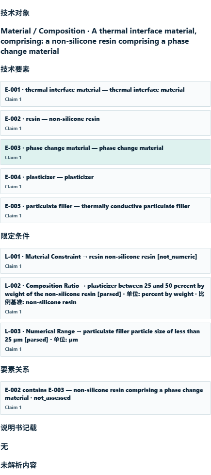

*系统把一段 Claim 1 整理成可查字段；字段仍是机器候选，关系需人工判断。*

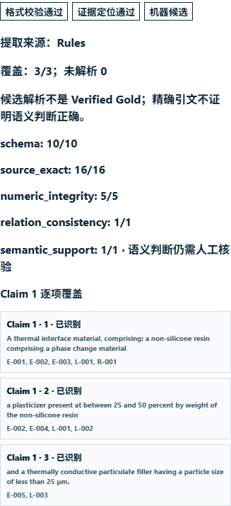

*格式检查说明字段结构合规；证据定位检查原文与来源；覆盖提示未映射片段。三者都不能替代人工语义审核。*

Rules 免费、无需模型，但复杂结构或长句可能遗漏、误绑限定。Grok 4.3 是可选的**付费语义辅助**，需服务端 Key、免费费用预检、明确确认和独立执行，也不保证完整正确。Schema 通过 ≠ 技术正确；Evidence 精确匹配 ≠ 引文真正支持解释；“人工已修订”也不自动等于整篇专利核实。解析不判断专利有效性、侵权或 FTO。

## 场景 D：研发要求比较两篇专利

**人工比较适合**两篇已登记但尚无可靠 Feature Record，或需要把关键差异先交研发讨论的情况。选择 A/B，阅读各自 Claim 1，写技术区别，分别粘贴双方**连续、逐字一致**的引文，附备注、修改人并保存，不需 AI。示例 A 的塑化剂比例以树脂重量为基准，B 则以总组成物为基准；这是一条值得核查的技术区别，不能仅凭数字相近断言方案等同。

**机器候选比较适合**两篇均已有 Feature Record，希望快速看到候选对应、未匹配要素与双方证据时。进入 `/patent-repository?task=compare` 选两份记录，打开 `/patent-compare` 的可选“机器候选比较”。相同名称可能指不同结构；候选对应不代表技术等同。机器遗漏的要素必须回原文核查，不能把“未匹配”解释成某篇权利要求没有该要素。交给研发的材料应包含两侧引文、差异解释及待核实事项，而非只有自然语言模型结论。

**跟着操作：**从登记详情“加入人工研究项目”，或直接到比较页的“人工研究（无需技术提取）”；先创建集合，选 `EP9000001A1` 和 `EP9000002A1`。差异栏写两个比例基准；A 引文粘贴 `between 25 and 50 percent by weight of the non-silicone resin`，B 引文粘贴 `between 30 and 55 percent by weight of the total composition`，再填备注与修改人、保存。无效引文会被拒绝，须回原文修正。

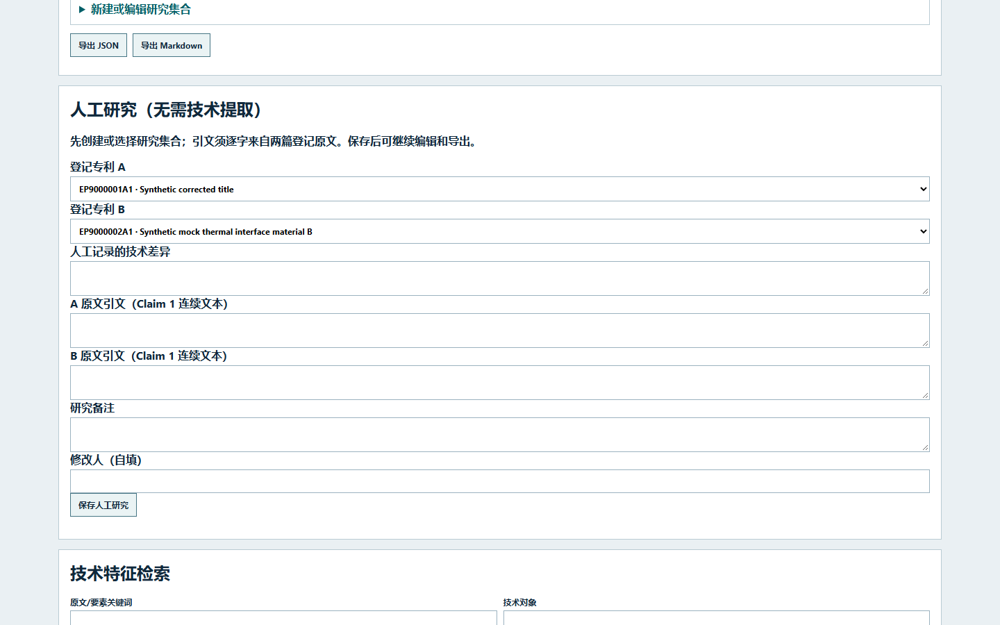

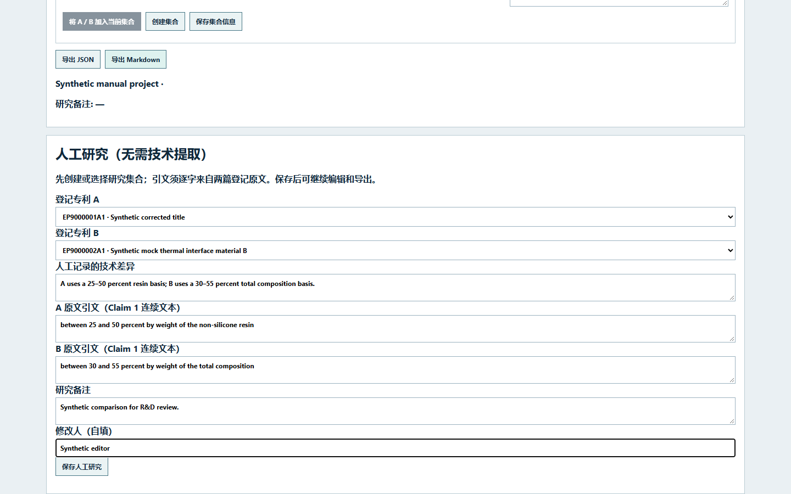

*系统保存自填差异及来源位置，标记“未核实”，不生成技术等同结论。*

## 场景 E：持续开展专题研究

Research Collection 是**研究资料夹**：可放入已登记文献及人工备注，也可保存选定版本的 Feature Snapshot。它不等于企业拥有的专利资产组合、专利族或权属登记。为某个散热专题创建集合后，加入两篇文献、差异与引文；刷新、重选集合即可继续编辑。导出 **Markdown** 适合人阅读、邮件讨论或会议备忘；**JSON** 适合交给其他系统作结构化交换。分享前检查来源状态、人工／机器标签和未确认事项。

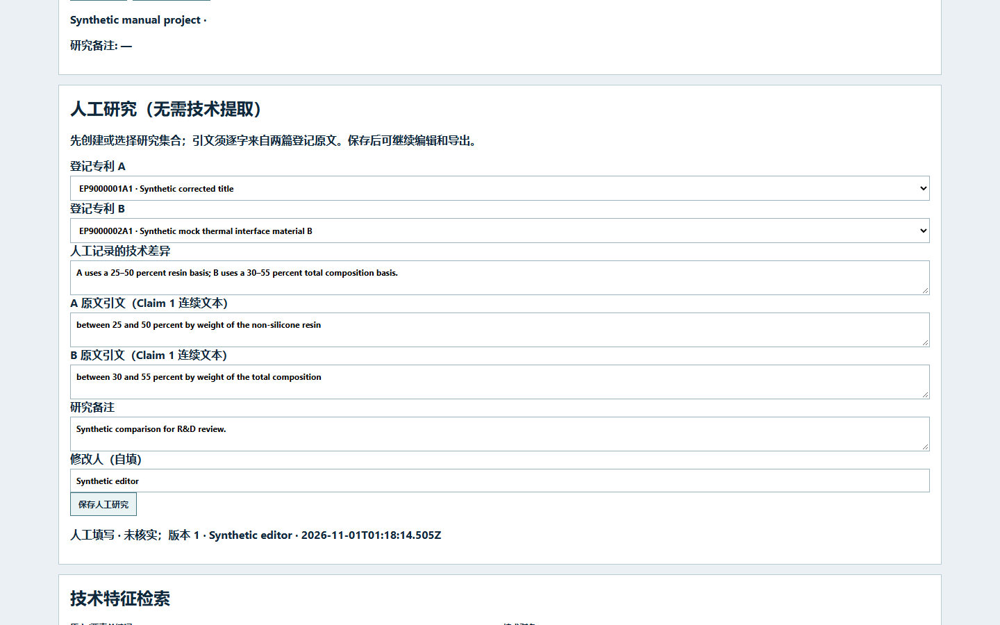

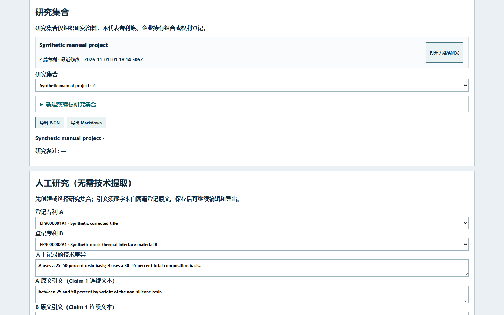

*两种文件都应包含所选集合的公开号、差异、引文及状态；浏览器演示已实际下载并读取核对。*

界面可切换中文与英文；语言切换不翻译原始专利文本，也不改变保存内容。窄屏可操作，长权利要求更适合桌面阅读。

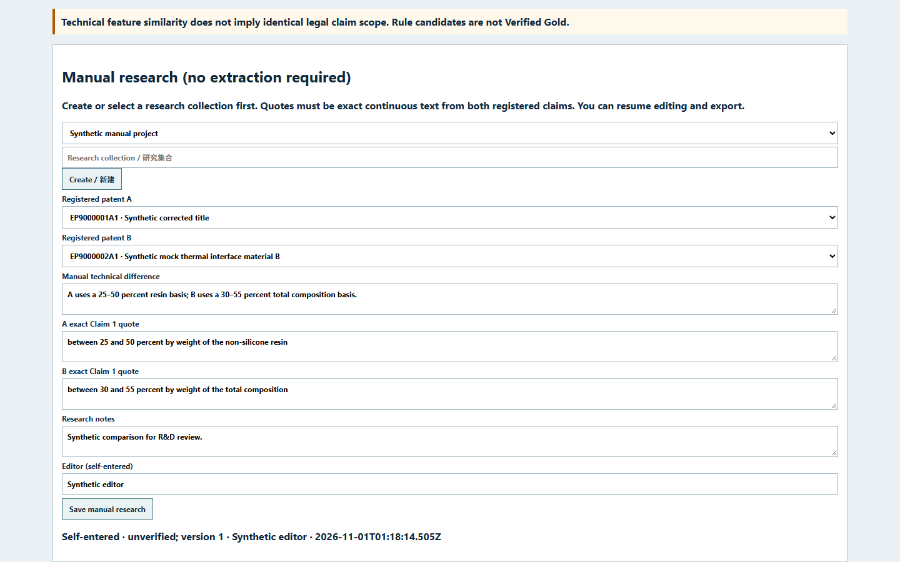

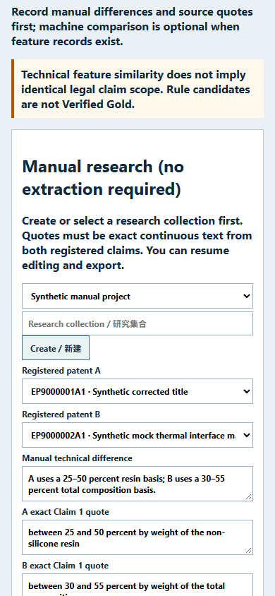

## 功能速查与入口边界

| UI 功能 | 输入 | 实际处理与输出 | 企业用途／限制 |
| --- | --- | --- | --- |
| `/pilot` 导入文件 | CSV／JSON 字段 | 校验并按公开号登记、去重 | 批量建档；不自动补齐全文 |
| `/patent-search` 手动输入 | 粘贴 Claim／摘要／说明书 | 放入当前阅读及测试区 | 临时核查；**不写入登记册** |
| EPO 导入 | EP 公开号 | 联网读取官方 XML 可得字段并登记 | 核对来源；受网络与可用性限制 |
| 公开号检索／元数据更正 | 编号／允许字段、原因 | 过滤列表；保存当前值及履历 | 查找与可追溯维护 |
| 人工标签 | 标签、修改人 | 保存自填标签及修订 | 专题线索，非机器要素 |
| Rules／Grok 解析 | 已有专题 Claim 1 | 生成要素、限定、关系候选 | 后续字段检索；Grok 付费且须授权 |
| Coverage Review／技术特征检索 | 解析记录／查询条件 | 标出映射与潜在缺口；返回字段或文本候选 | 定位待核查内容；不保证完整 |
| 双专利机器比较 | 两份 Feature Records | 候选对应、未匹配项、双方证据 | 初筛差异；不证明等同 |
| 人工差异记录 | 两篇登记文献、双侧引文 | 保存自填差异和版本 | 无 AI 也能整理研究 |
| 研究集合／导出 | 文献、特征版本、备注 | 保存、恢复、下载 Markdown／JSON | 复用研究，不是权属组合 |
| `/pilot` 组合统计／AI 分类／模型对照 | 登记字段／实验任务 | 按口径统计或产生实验候选 | **高级旧版实验**；未接入统一企业审核流程 |

**常见问题：**没有 Key 可以登记、人工比较、用 Rules 和导出；没有 Feature Record 可人工比较，但特征库不会自动检索该篇；资料错误可在登记详情更正元数据并看履历。任何机器候选或自填意见都不自动成为 Verified Gold。其他边界见[能力与限制](capabilities.md)。
